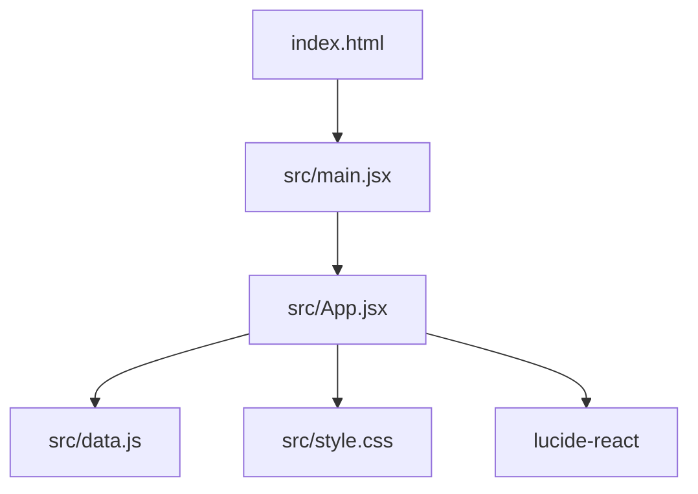

# System Map

## Repo Shape

This is a single frontend application, not a monorepo. There are no packages, server services, migrations, workers, CI workflows, or test folders at inspection time.

```text
buildsubbox/
  index.html              browser document and React mount
  package.json            npm scripts and dependencies
  vite.config.js          Vite + React plugin
  src/
    main.jsx              React root
    App.jsx               application state, flows, components, scoring
    data.js               seed plans, subscriber, inventory, ratings, shipments
    style.css             global and component-level styles
  public/
    favicon.svg
    icons.svg
```

## Runtime Diagram



## Ownership Map

| Area | Owner in this repo | Anchors | Notes |
| --- | --- | --- | --- |
| Browser entry | HTML and Vite | [`index.html`](../../../index.html#L9-L11), [`vite.config.js`](../../../vite.config.js#L1-L6) | Public mount only. |
| React root | `main.jsx` | [`src/main.jsx`](../../../src/main.jsx#L1-L10) | StrictMode wrapper. |
| Navigation shell | `App` | [`src/App.jsx`](../../../src/App.jsx#L40-L46), [`src/App.jsx`](../../../src/App.jsx#L110-L168) | Tab IDs are local UI contract. |
| Domain state | `App` local state | [`src/App.jsx`](../../../src/App.jsx#L64-L108) | In-memory only. |
| Seed data | `data.js` | [`src/data.js`](../../../src/data.js#L1-L203) | Mock source of truth on load. |
| Styling | CSS | [`src/style.css`](../../../src/style.css#L1-L710) | Global stylesheet, no CSS modules. |
| Billing simulation | `Billing` component | [`src/App.jsx`](../../../src/App.jsx#L298-L399) | Not integrated with Stripe. |
| Fulfillment simulation | `Fulfillment` component | [`src/App.jsx`](../../../src/App.jsx#L556-L635) | Not a real background job. |

## Public Interfaces vs Private Internals

Public to the browser:

- The HTML mount and module script at [`index.html`](../../../index.html#L9-L11).
- The rendered React UI in [`src/App.jsx`](../../../src/App.jsx#L110-L168).

Private implementation details:

- State shape in [`src/App.jsx`](../../../src/App.jsx#L64-L108).
- Seed object shape in [`src/data.js`](../../../src/data.js#L31-L203).
- Scoring formula in [`src/App.jsx`](../../../src/App.jsx#L719-L725).

Possible future public contracts:

- Subscription API endpoints.
- Stripe webhook payload handling.
- Shipment batch job interface.
- Persisted data schema.

Do not treat current seed object shapes as stable external contracts until the project adds validation and tests.
